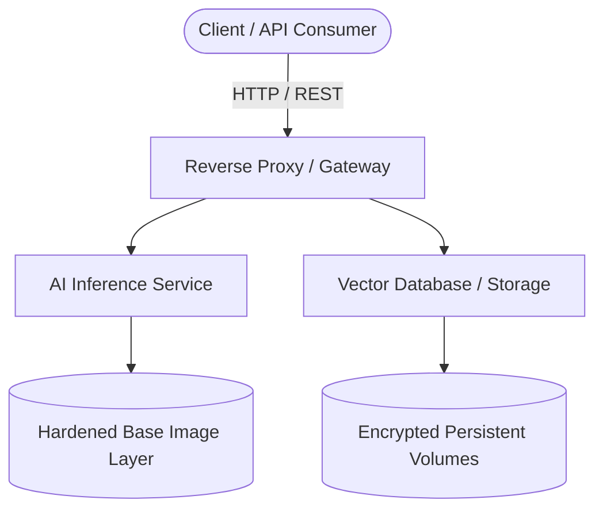

# Dockerized AI Stack using docker-compose and Hardened Images

## 🎓 Project Supervision & Team

### **Project Supervisor**
* **Assistant Professor Shaik Asif**  
  Department of Computer Science and Engineering (CSE)  

### **Project Team**
| Role | Name | ID Number |
| :--- | :--- | :--- |
| **Team Member 1** | D. Hemasai | `2520030599` |
| **Team Member 2** | M. Nikhil Reddy | `2520030560` |

---

## 📖 Table of Contents
1. [About the Project](#-about-the-project)
2. [Key Architecture & Security Features](#-key-architecture--security-features)
3. [System Architecture Diagram](#-system-architecture-diagram)
4. [Tech Stack](#-tech-stack)
5. [Prerequisites](#-prerequisites)
6. [Getting Started & Installation](#-getting-started--installation)
7. [Environment Variables Configuration](#-environment-variables-configuration)
8. [Running the Application](#-running-the-application)
9. [Project Structure](#-project-structure)
10. [Troubleshooting & FAQ](#-troubleshooting--faq)
11. [License](#-license)

---

## 🧐 About the Project

Deploying Artificial Intelligence models in production environments often brings unique challenges regarding security vulnerabilities, heavy resource overhead, and orchestration complexity.

The **Dockerized AI Stack** project addresses these challenges by offering a streamlined, containerized ecosystem managed via `docker-compose`. By implementing **security-hardened images** (utilizing minimal base OS layers, non-root user enforcement, and reduced CVE surfaces), this repository ensures that your AI services remain resilient against common container-based attack vectors without sacrificing performance or flexibility.

---

## 🛡️ Key Architecture & Security Features

* **Minimized Attack Surface:** Built upon lightweight, stripped-down hardened base images, drastically lowering vulnerability counts.
* **Non-Root Execution:** Services run with restricted privileges to prevent container escape vulnerabilities.
* **Orchestration Simplicity:** Manage complex multi-container workflows (models, APIs, databases, vector stores) with a single `docker-compose` command.
* **Resource Optimization:** Granular CPU and GPU allocation capabilities for heavy AI inference and training workloads.
* **Persistent Volumes:** Secure data persistence ensuring zero data loss across container lifecycles.

---

## 📊 System Architecture Diagram



---

## ⚙️ Tech Stack

* **Orchestration:** Docker Compose V2
* **Containerization:** Docker Engine, Hardened Alpine/Distroless Base Images
* **AI Frameworks / Runtimes:** Python, PyTorch / TensorFlow (configurable)
* **Environment Control:** Dotenv (`.env`)

---

## 📋 Prerequisites

Before you begin, ensure your host environment meets the following specifications:

* **Docker Engine:** `v20.10.0` or higher
* **Docker Compose:** `v2.0.0` or higher
* **Hardware:** Minimum 8GB RAM, 4 CPU cores (NVIDIA GPU with CUDA Toolkit recommended for accelerated AI inference).

Verify your installations via terminal:

```bash
docker --version
docker compose version
```

---

## 🚀 Getting Started & Installation

### 1. Clone the Repository
Clone this repository to your local machine or server environment:

```bash
git clone https://github.com/your-username/dockerized-ai-stack.git
cd dockerized-ai-stack
```

### 2. Configure Environment Variables
Create a production configuration file based on the provided template:

```bash
cp .env.example .env
```

Open the `.env` file using your preferred text editor (e.g., `nano .env` or `code .env`) and supply the required API keys, database credentials, and port configurations.

---

## 🏃‍♂️ Running the Application

### Build and Launch Services
To build the hardened images from scratch and spin up the entire stack in detached mode, run:

```bash
docker compose up --build -d
```

### Monitor Logs and Status
Check real-time health and container statuses:

```bash
docker compose ps
```

To view live logs for debugging or monitoring:

```bash
docker compose logs -f
```

### Graceful Shutdown
To stop the services while preserving your persistent data volumes:

```bash
docker compose down
```

---

## 📁 Project Structure

```text
dockerized-ai-stack/
├── 📁 config/               # Configuration files for services
├── 📁 docs/                 # Architecture documentation & diagrams
├── 📁 src/                  # Application source code and model wrappers
├── 📄 .env.example          # Sample environment variables template
├── 📄 .gitignore            # Git exclusion rules
├── 📄 docker-compose.yml    # Main multi-container composition file
├── 📄 Dockerfile            # Security-hardened custom container build file
└── 📄 README.md             # Project documentation (You are here)
```

---

## ❓ Troubleshooting & FAQ

* **Issue: Container exits immediately with code 137.**
  * *Solution:* This usually indicates an Out-Of-Memory (OOM) error. Allocate more RAM to your Docker Desktop settings or limit container memory usage in `docker-compose.yml`.

* **Issue: GPU acceleration not recognized.**
  * *Solution:* Ensure you have installed the [NVIDIA Container Toolkit](https://docs.nvidia.com/datacenter/cloud-native/container-toolkit/install-guide.html) and configured runtime options in your compose file.

---

## 📜 License

This project is licensed under the terms of the **MIT License**. See the [LICENSE](LICENSE) file for details.